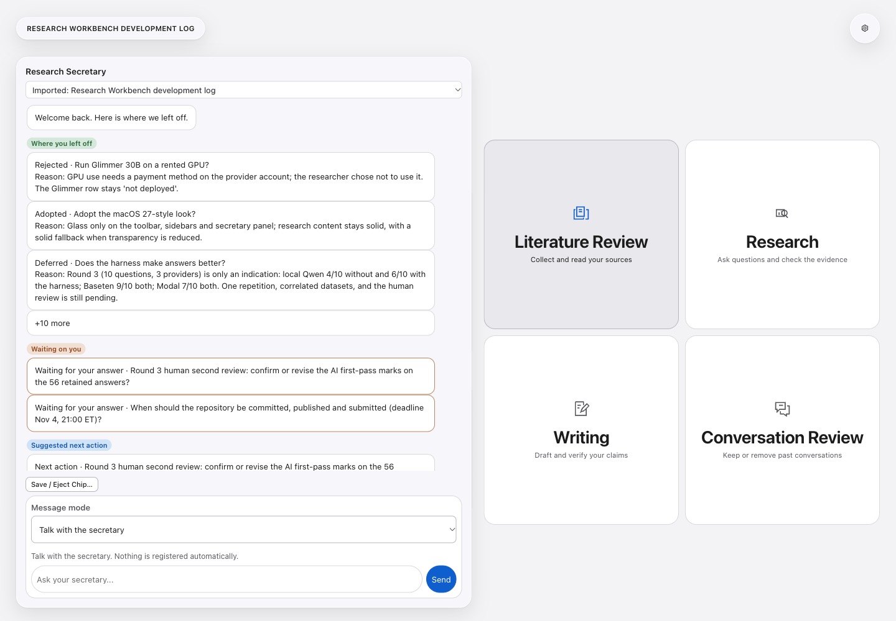
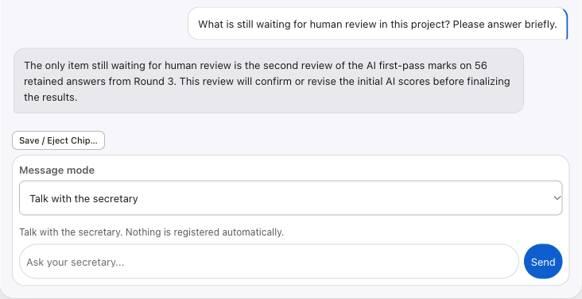
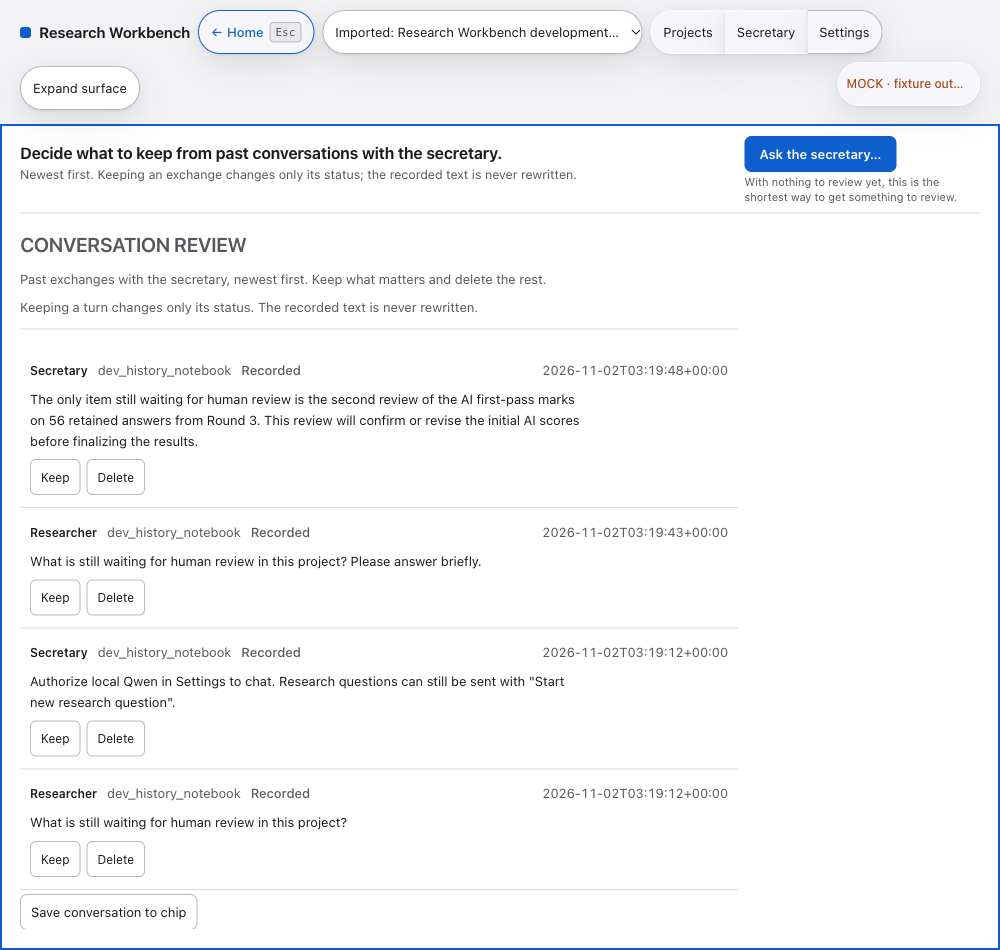

# Research Workbench

A local-first research secretary that remembers the project context, helps check claims against evidence, and lets you inspect what a model will receive.

[English](README.md) / [한국어](docs/README.ko.md)


<a href="https://github.com/ManinSpurs/research-workbench-hackathon/releases/tag/v1.1.0"></a>

Apple silicon, v1.1.0. [First launch](#install-on-macos) · [Quick tour](#quick-tour) · [Try a chip](#take-the-context-with-you) · [Model comparison](#local-qwen-and-muse-spark)



The public development-log notebook, open in the browser development build. [About these screenshots](docs/assets/README.md).

## Quick tour

Come back to a project and see the decisions you recorded, the questions waiting for you, and the suggested next action. Open the sources behind a claim before deciding what to keep.

| Work area | What you do there |
| --- | --- |
| Literature Review | Collect sources, read documents and keep notes beside them. |
| Research | Work through questions, evidence and the secretary briefing. |
| Writing | Draft, compose citations, check claims and work with LaTeX. |
| Conversation Review | Inspect past exchanges and choose what to keep or remove. |

Settings keeps model routes, credentials, local runtime and language in one place.

### Talk with the secretary

Ask about your research, suggest an idea, or ask what to do next. The secretary uses the open project's briefing and recent conversation as context. Local Qwen is the default; its weights and runtime need separate setup.



This reply is from the earlier recorded local Qwen run in the development environment. Chat messages stay in Conversation Review. A message becomes a research question only when you choose **Register as research question**.

### Keep a record

Review the exchange later, keep what matters, or remove it. Keeping an exchange changes its status; it does not rewrite the recorded words.



### Check a claim

Choose a claim and registered evidence. Inspect the transmission preview, then explicitly authorize the research model request. The app checks returned quotes verbatim against the excerpt actually sent and keeps a receipt with model and calculated usage information.

A verbatim match proves the quote occurs in that excerpt. Whether it supports the claim still needs review.

## Take the context with you

A `.chip` packages reusable research context and, optionally, a saved notebook. It carries no model weights or credentials, and code stored in a record stays data rather than being executed.

Download a development log and use **Open Chip** in the app:

- [English development log](https://github.com/ManinSpurs/research-workbench-hackathon/releases/download/v1.1.0/research_workbench_dev_log_en.chip)
- [한국어 개발 일지](https://github.com/ManinSpurs/research-workbench-hackathon/releases/download/v1.1.0/research_workbench_dev_log_ko.chip)

These authored records show recorded decisions, evidence and unfinished work. For a fictional research example, choose **Try the sample chip**, or open [`sample_permit_notebook.chip`](current/rehearsal_build/chips/builtin/sample_permit_notebook.chip).

Read the [chip format](current/CHIP_FILE_FORMAT_EN.md) to inspect the archive or build your own.

## Install on macOS

1. Download the Apple silicon DMG from the [v1.1.0 release](https://github.com/ManinSpurs/research-workbench-hackathon/releases/tag/v1.1.0).
2. Open it and drag Research Workbench into Applications.
3. Launch the app and open a development-log chip or try the sample.

**This build is not signed or notarized.** If macOS blocks the first launch, try opening it once, then go to **System Settings > Privacy & Security > Security > Open Anyway** and confirm. Only approve a download you trust; keep system security enabled.

Browsing the app does not require cloud inference. Local inference requires separately configured model weights and a llama.cpp runtime. The packaged DMG's actual Qwen conversation remains unverified; the recorded Qwen conversation was checked in the development environment. LaTeX compilation uses its optional engine.

<details>
<summary>Run from source</summary>

Python 3.11+ and Node.js are required.

```sh
git clone https://github.com/ManinSpurs/research-workbench-hackathon.git
cd research-workbench-hackathon/current/rehearsal_build
python3 -m venv .venv
.venv/bin/python -m pip install -r requirements.txt
npm ci
./Start_Mock.command
```

The launcher starts the local mock services. In another terminal in `current/rehearsal_build`, run `npm run app` to open Electron. Stop the launcher and its services when finished. Model weights and the llama.cpp runtime are separate optional downloads.

</details>

## Models and privacy

| Route | Setup and scope |
| --- | --- |
| Local Qwen3-4B Instruct | Separate weights and local runtime. Local compute has no API charge. |
| Baseten Muse Spark Open | Your Baseten account and key; model `meta-models/muse-spark-open-1026`. Available for research and secretary chat. |
| Modal Shared Muse Spark Open | Your Modal account and key. Supported research route. |

Paid secretary chat requires a one-time consent in Settings. Research model requests use their own transmission previews and content-bound consent. Replies display their model and calculated cost; those figures are not provider invoices.

Keys belong in environment variables or owner-only local configuration files. Opening Settings does not run a model. The app cannot verify provider balances or promotional coverage; its spending limits supplement your provider's billing controls.

## Local Qwen and Muse Spark

Round 3 explored task successes across ten planned questions per arm. **These are AI first-pass scores. Human second review is still pending.**

| Provider | Basic | With harness |
| --- | ---: | ---: |
| Local Qwen | 4/10 | 6/10 |
| Baseten Muse Spark Open | 9/10 | 9/10 |
| Modal Shared Muse Spark Open | 7/10 | 7/10 |

The experiment retained 56 of 60 planned answers. It is an exploratory comparison, not evidence of general model superiority.

<details>
<summary>Read the comparison limits and review status</summary>

- The execution assistant scored the answers; it was not an independent reviewer. Human second review has not occurred.
- Three correlated datasets, one sample per case-arm, unequal provider profiles and missing answers limit interpretation. Modal had eight scored answers per arm; the table uses ten planned questions as its denominator.
- Citation entailment is unknown. False-citation rates are null, not zero.
- A Modal unknown-charge failure did not stop subsequent jobs as preregistered. This historical deviation was not replayed or repaired.
- Raw logs are deliberately excluded from this public repository.

The [preregistration and dated post-run record](current/HARNESS_COMPARISON_PREREG_EN.md) preserve the experiment's scope. Earlier `NOT_RUN` markers describe historical stages, not the final round-3 status.

</details>

## Hackathon scope

The research and evidence workflow builds on an earlier local rehearsal. Secretary briefings, adaptive readiness, consent-bound model orchestration and chips include event-period additions. The [contribution ledger](current/HACKATHON_CONTRIBUTION_LEDGER_EN.md) cites files and distinguishes inherited work from hackathon work; dated entries retain their original scope.

Independent scientific validation remains `NOT_RUN`. Autonomous background research and full segmentation masks remain `NOT_IMPLEMENTED`. Legacy or experimental provider entries do not establish live endpoint support.

<details>
<summary>Source checks and browser review</summary>

After installing the source dependencies:

```sh
cd current/rehearsal_build
TMPDIR=/tmp .venv/bin/python -m pytest tests -q
```

Browser review harnesses use Playwright (`npx playwright install chromium`). Some historical harnesses require excluded private verification artifacts or an independently running mock API, so they are not a source-only test lane. Source verification does not perform inference, paid smoke tests or deployment.

</details>

## License

The project's own source uses the [MIT License](LICENSE). Third-party components retain their own licenses, including Python packages, Electron and the TeX distribution in the DMG. Separately downloaded model weights retain their model licenses, including Apache-2.0 for Qwen3-4B.

[Download v1.1.0](https://github.com/ManinSpurs/research-workbench-hackathon/releases/tag/v1.1.0) · [Report an issue](https://github.com/ManinSpurs/research-workbench-hackathon/issues) · [한국어 안내](docs/README.ko.md)
