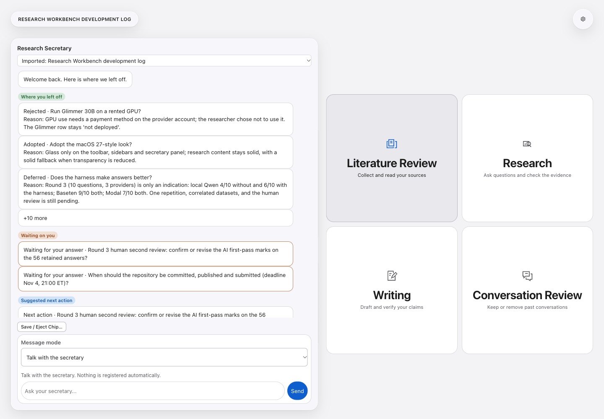
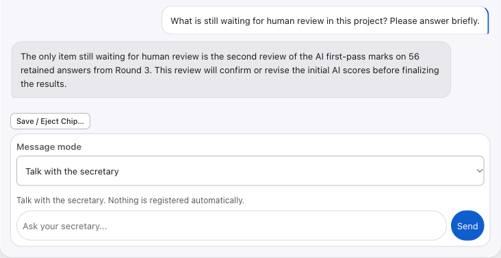
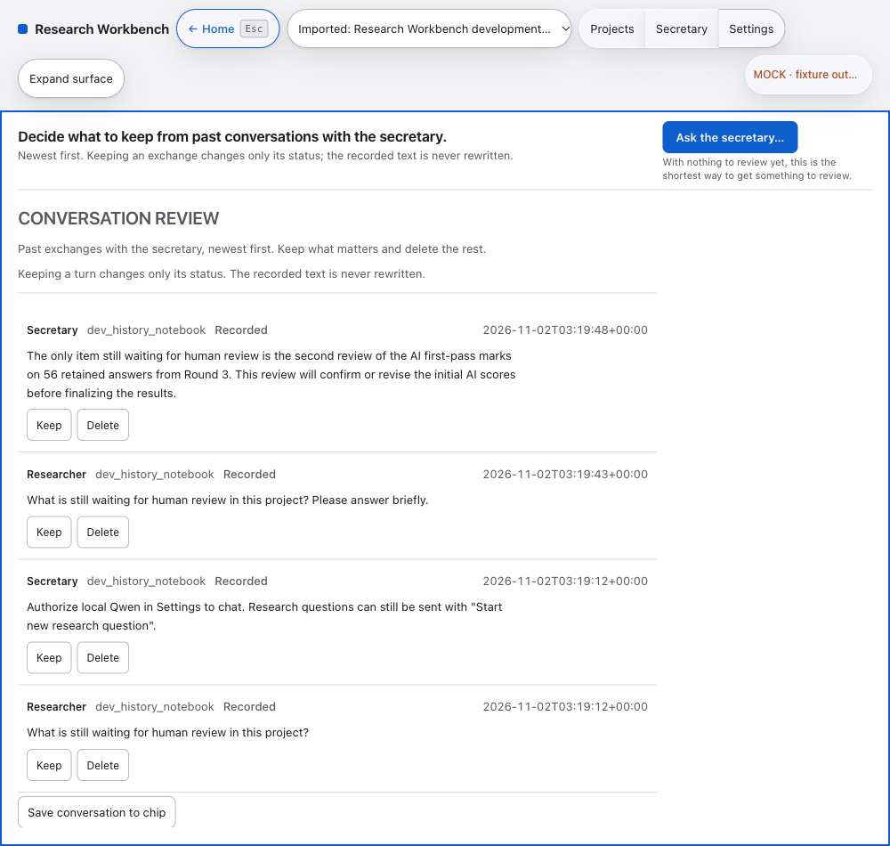

# Research Workbench

프로젝트의 맥락을 기억하고, 주장과 근거를 함께 살펴보도록 돕는 로컬 중심 연구 비서입니다. 모델에 보낼 내용을 확인한 뒤 연구 요청을 승인할 수 있습니다.

[English](../README.md) / [한국어](README.ko.md)


**[Mac용 v1.1.0 다운로드](https://github.com/ManinSpurs/research-workbench-hackathon/releases/tag/v1.1.0)**

Apple silicon용입니다. [설치 안내](#설치하기) · [개발 일지 칩](#맥락을-담아-옮기기) · [모델 비교](#로컬-qwen과-muse-spark)



공개 개발 일지 칩을 브라우저 개발 환경에서 연 화면입니다. [화면 자료 안내](assets/README.md)

## 어디서 시작하나요?

프로젝트를 다시 열면 기록해 둔 결정, 답을 기다리는 질문, 다음에 할 일을 비서 브리핑에서 확인할 수 있습니다. 판단하기 전에 주장에 연결된 근거도 살펴보세요.

| 작업 공간 | 할 수 있는 일 |
| --- | --- |
| Literature Review | 자료를 모으고 문서를 읽으며 메모합니다. |
| Research | 연구 질문과 근거를 검토하고 비서 브리핑을 확인합니다. |
| Writing | 초안, 인용, 주장 확인, LaTeX 작업을 진행합니다. |
| Conversation Review | 지난 대화를 살펴보고 보관하거나 삭제합니다. |

모델 경로, 인증 정보, 로컬 실행 환경, 언어는 Settings에서 관리합니다.

### 비서와 대화하기

연구 아이디어나 다음에 할 일을 편하게 물어보세요. 비서는 열린 프로젝트의 브리핑과 최근 대화를 참고합니다. 기본 모델은 로컬 Qwen이며, 모델 파일과 실행 환경은 별도로 설정해야 합니다.



위 답변은 앞서 개발 환경에서 실행한 로컬 Qwen 대화 기록입니다. 대화는 Conversation Review에 남으며, **Register as research question**을 눌러야 연구 질문으로 등록됩니다.

### 대화 기록 살펴보기

필요한 대화를 보관하거나 삭제할 수 있습니다. 보관 여부를 바꾸어도 기록된 문장은 다시 작성되지 않습니다.



### 주장과 근거 확인하기

주장과 등록된 근거 자료를 고른 뒤, 모델에 전송할 내용을 미리 확인하고 연구 요청을 승인합니다. 앱은 돌아온 인용문이 실제로 전송한 발췌문에 있는지 대조하고, 모델과 계산된 사용량을 영수증에 기록합니다.

문장이 발췌문에 있다는 사실과 그 문장이 주장을 뒷받침한다는 판단은 별개입니다. 내용의 타당성은 사람이 검토해야 합니다.

## 맥락을 담아 옮기기

`.chip`은 연구 맥락과 선택적으로 저장된 노트를 담는 파일입니다. 모델 가중치나 인증 정보는 포함하지 않습니다. 기록 속 코드는 자료로 보관되며 실행되지 않습니다.

개발 일지를 내려받아 앱의 **Open Chip**으로 열어보세요.

- [한국어 개발 일지 칩](https://github.com/ManinSpurs/research-workbench-hackathon/releases/download/v1.1.0/research_workbench_dev_log_ko.chip)
- [영어 개발 일지 칩](https://github.com/ManinSpurs/research-workbench-hackathon/releases/download/v1.1.0/research_workbench_dev_log_en.chip)

두 파일에는 개발 과정에서 작성한 결정, 근거, 미완료 작업이 들어 있습니다. 가상 연구 사례를 보려면 앱에서 **Try the sample chip**을 선택하거나 [`sample_permit_notebook.chip`](../current/rehearsal_build/chips/builtin/sample_permit_notebook.chip)을 열어보세요.

구조를 살펴보거나 직접 칩을 만들려면 [파일 형식 설명](../current/CHIP_FILE_FORMAT_EN.md)을 참고하세요.

## 설치하기

1. [v1.1.0 릴리스](https://github.com/ManinSpurs/research-workbench-hackathon/releases/tag/v1.1.0)에서 Apple silicon용 DMG를 받습니다.
2. DMG를 열고 Research Workbench를 Applications 폴더로 옮깁니다.
3. 앱을 실행해 개발 일지 칩을 열거나 예제 칩을 체험합니다.

**아직 Apple 서명과 공증이 없는 빌드입니다.** 첫 실행이 차단되면 앱을 한 번 열어본 뒤 **시스템 설정 > 개인정보 보호 및 보안 > 보안 > 확인 없이 열기**에서 승인하세요. 신뢰하는 다운로드만 승인하고 시스템 보안은 켜 두세요.

앱을 둘러보는 데 클라우드 모델 호출은 필요하지 않습니다. 로컬 추론에는 별도의 모델 파일과 llama.cpp 실행 환경이 필요합니다. 패키징된 DMG 안에서 실제 Qwen 대화가 되는지는 아직 검증하지 못했습니다. 녹화에 사용한 실제 Qwen 대화는 개발 환경에서 확인했습니다. LaTeX 컴파일에는 선택 구성 요소인 엔진이 필요합니다.

<details>
<summary>소스에서 실행하기</summary>

Python 3.11 이상과 Node.js가 필요합니다.

```sh
git clone https://github.com/ManinSpurs/research-workbench-hackathon.git
cd research-workbench-hackathon/current/rehearsal_build
python3 -m venv .venv
.venv/bin/python -m pip install -r requirements.txt
npm ci
./Start_Mock.command
```

실행기는 로컬 모의 서비스를 시작합니다. 다른 터미널에서 같은 `current/rehearsal_build` 폴더로 이동한 뒤 `npm run app`을 실행하면 Electron 앱이 열립니다. 사용을 마치면 실행기와 서비스를 종료하세요. 모델 파일과 llama.cpp 실행 환경은 별도 선택 다운로드입니다.

</details>

## 모델과 개인정보

| 경로 | 준비할 항목과 사용 범위 |
| --- | --- |
| 로컬 Qwen3-4B Instruct | 모델 파일과 로컬 실행 환경이 필요합니다. 로컬 계산에는 API 요금이 없습니다. |
| Baseten Muse Spark Open | 본인의 Baseten 계정과 키가 필요합니다. 모델은 `meta-models/muse-spark-open-1026`이며 연구와 비서 대화에 사용합니다. |
| Modal Shared Muse Spark Open | 본인의 Modal 계정과 키가 필요합니다. 연구 요청에 사용할 수 있습니다. |

유료 비서 대화를 사용하려면 Settings에서 한 번 동의해야 합니다. 연구 모델 요청에는 별도의 전송 미리보기와 내용에 연결된 동의 절차가 적용됩니다. 표시되는 모델 비용은 계산값이며 제공업체의 청구서와 대조한 금액은 아닙니다.

키는 환경 변수나 소유자만 읽을 수 있는 로컬 설정 파일에 보관합니다. Settings를 여는 것만으로 모델을 호출하지 않습니다. 앱은 제공업체 잔액이나 프로모션 적용 여부를 확인하지 못합니다. 앱의 지출 제한과 함께 제공업체의 결제 한도도 설정하세요.

## 로컬 Qwen과 Muse Spark

3차 실험은 조건별로 계획된 질문 10개에 대한 과제 성공 수를 비교했습니다. **AI의 1차 채점 결과이며, 사람의 2차 검수는 아직 끝나지 않았습니다.**

| 제공 경로 | 기본 | 하네스 사용 |
| --- | ---: | ---: |
| 로컬 Qwen | 4/10 | 6/10 |
| Baseten Muse Spark Open | 9/10 | 9/10 |
| Modal Shared Muse Spark Open | 7/10 | 7/10 |

계획된 답변 60개 중 56개를 보존했습니다. 탐색적 비교이므로 모델의 전반적인 우열을 입증하는 결과로 해석할 수 없습니다.

<details>
<summary>비교의 한계와 검수 상태</summary>

- 실행을 담당한 AI 비서가 채점했습니다. 독립 검토자의 평가가 아니며 사람의 2차 검수도 수행하지 않았습니다.
- 서로 연관된 데이터셋 3개, 사례와 조건별 표본 1개, 제공 경로별 설정 차이, 누락 답변 때문에 해석에 한계가 있습니다. Modal은 조건별로 답변 8개를 채점했으며 표의 분모는 계획된 질문 10개입니다.
- 인용문이 주장을 뒷받침하는지는 확인되지 않았습니다. 허위 인용률은 0이 아니라 미확인 값입니다.
- Modal에서 비용을 알 수 없는 실패가 발생한 뒤에도 사전 계획과 달리 후속 작업이 진행됐습니다. 이 과거 이탈은 재실행하거나 사후 수정하지 않았습니다.
- 원시 로그는 공개 저장소에서 제외했습니다.

[사전 등록 문서와 날짜가 있는 사후 기록](../current/HARNESS_COMPARISON_PREREG_EN.md)에서 범위를 확인할 수 있습니다. 문서의 예전 `NOT_RUN` 표시는 당시 단계의 상태이며 최종 3차 실행 상태를 뜻하지 않습니다.

</details>

## 해커톤 작업 범위

연구와 근거 관리 흐름은 이전 로컬 리허설에서 이어받았습니다. 비서 브리핑, 준비 상태 판단, 동의에 연결된 모델 실행, 칩에는 대회 기간에 추가한 작업이 포함됩니다. [기여 기록](../current/HACKATHON_CONTRIBUTION_LEDGER_EN.md)은 파일 근거와 함께 이전 작업과 대회 작업을 구분합니다. 각 날짜의 기록은 당시 범위에 한정됩니다.

독립적인 과학적 타당성 검증은 `NOT_RUN`입니다. 자율 백그라운드 연구와 전체 분할 마스크는 `NOT_IMPLEMENTED`입니다. 예전 또는 실험용 모델 항목이 있다고 해서 실제 엔드포인트 지원이 확인된 것은 아닙니다.

소스 검사와 브라우저 검토 실행 방법은 [영문 안내](../README.md#hackathon-scope)에 있습니다. 소스 검증에는 실제 추론, 유료 호출 검사, 배포가 포함되지 않습니다.

## 라이선스

프로젝트 자체 소스는 [MIT 라이선스](../LICENSE)로 공개합니다. Python 패키지, Electron, DMG의 TeX 배포본 등 외부 구성 요소는 각각의 라이선스를 따릅니다. 별도로 받는 모델 가중치에도 해당 모델의 라이선스가 적용되며 Qwen3-4B는 Apache-2.0입니다.

[다운로드](https://github.com/ManinSpurs/research-workbench-hackathon/releases/tag/v1.1.0) · [문제 제보](https://github.com/ManinSpurs/research-workbench-hackathon/issues) · [English](../README.md)
